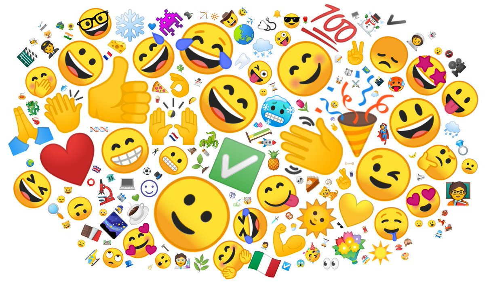

# Tieba-Emoji

[中文版](./README/README.zh.md) 
EMOJI collections repo 
<s>The emoticons of Baidu Tieba have long been considered a classic representation of an entire generation. Emotions like Funny are used by many perple, even outside Tieba. The project collects and  acquires all emotions in Tieba Web Version.</s>
 
This is the repo to collect all emotions in different social media. Free feel to contribute.

## Getting Started
All emoji is in Google Drive

- Tieba(貼吧) 
    [Google Drive](https://drive.google.com/file/d/1lWohq13xa3OrWQ2vLBrooWtLqyLRjPFm/view?usp=sharing)
- BiLiBiLi 
    [Google Drive](https://drive.google.com/file/d/13SZgpIIJ1q4iznHJsJI1pt9EiXIeKzZr/view?usp=sharing)

## EMOJI Detail

### Tieba
The below table is the reference to each group. The emoji image is in ***emotion/<emoji_type>/<file_name>.png***

| Emotion Type | the directory  |
|:------------:|:--------------------:|
| 默认           | emotion/regular      |
| 熊孩子          | emotion/bearchildren |
| 痒小贱          | emotion/tiexing      |
| 阿狸           | emotion/ali          |
| 罗罗布          | emotion/luoluobu     |
| 气泡熊          | emotion/qpx_n        |
| 小幺鸡          | emotion/xyj          |
| 冷兔           | emotion/lt           |
| 白发魔女         | emotion/bfmn         |
| 张小盒          | emotion/pczxh        |
| 兔斯基          | emotion/tsj          |
| 豌豆荚          | emotion/wdj          |
| 冷先森          | emotion/lxs          |
| 暴漫静态         | emotion/baodong      |
| 暴漫动态         | emotion/baodong_d    |
| 波波           | emotion/bobo         |
| 影子           | emotion/shadow       |
| 绿豆蛙          | emotion/ldw          |
| 十周年          | emotion/10th         |

### Bilibili
Emoji in Bilibili divides into 4 group. 
> tv_小电视 
> 小黄脸 
> 热词系列一 
> 颜文字 

## Notice
1. The above emoticons are for personal use only. Please do not use them for commercial purposes.
2. If you want to use the emoticons, please download them yourself.

